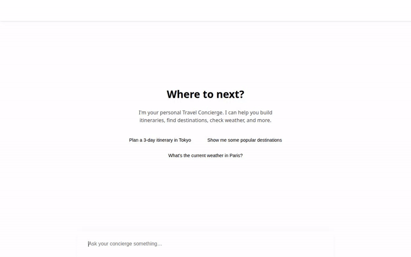

# Travel Concierge

Travel Concierge is a conversational AI travel planning assistant built with the Google Agent Development Kit (ADK) and `gemini-2.5-flash`. It integrates with multiple APIs and Google Cloud services to help users check weather, convert currencies, view destinations, and even generate multimodal content like images and video on demand.



## Capabilities & Implemented Tools

The agent currently implements the following tools and capabilities:

- **Destination Catalog (Firestore)**: Retrieves, lists, and adds travel destinations (complete with categories, descriptions, recommended days, and highlights) directly from a Google Cloud Firestore database.
- **Location & Nearby Places (Google Maps)**: Geocodes addresses into coordinates and searches for nearby tourist attractions, restaurants, or museums using the Google Maps Places API.
- **Multimodal Generation (Vertex AI & Cloud Storage)**: 
  - **Image Generation**: Generates high-quality preview images of destinations using `gemini-3.1-flash-lite-image` and uploads them directly to a public Google Cloud Storage bucket.
  - **Video Generation**: Creates short cinematic videos of destinations using the new `gemini-omni-flash-preview` model via the Interactions API, also hosted via Cloud Storage.
- **Live Utility APIs**:
  - Fetches real-time weather and temperature using Open-Meteo.
  - Retrieves live currency exchange rates.
  - Checks current time across timezones.
- **Long-term Memory (Google Cloud Memory Bank)**: Leverages `VertexAiMemoryBankService` to recall a user's travel preferences, budget limits, dietary restrictions, and past trip history across sessions.
- **Code Execution Sandbox**: Utilizes the `AgentEngineSandboxCodeExecutor` allowing the agent to securely write and run Python scripts dynamically (e.g., for complex budget breakdown calculations).
- **Rich UI (A2UI)**: Configured with an A2A schema and an `after_model_callback` to return structured JSON components (Cards, Columns, Images) to compatible frontends.

> **Note**: An **Itinerary calculator** was originally planned for this project but is not yet implemented.

## Local Development & Setup

This project uses the `agents-cli` framework for deployment to Google Cloud Agent Engine. To run it locally alongside the custom chat frontend:

1. **Start the Agent Backend (Playground)**
   From the root of this project:
   ```bash
   agents-cli playground
   ```
   This will expose the reasoning engine locally.

2. **Start the Custom Frontend**
   In a new terminal, navigate to the frontend directory and start the proxy server:
   ```bash
   cd frontend
   ./run.sh
   ```
   *Alternatively, if you prefer running it manually:*
   ```bash
   export AGENT_DIRECTORY="app"
   # (Set AGENT_ENGINE_RESOURCE_NAME to point to your deployment if necessary)
   python main.py
   ```
   The UI will be available at `http://127.0.0.1:8080` (or wherever configured).
